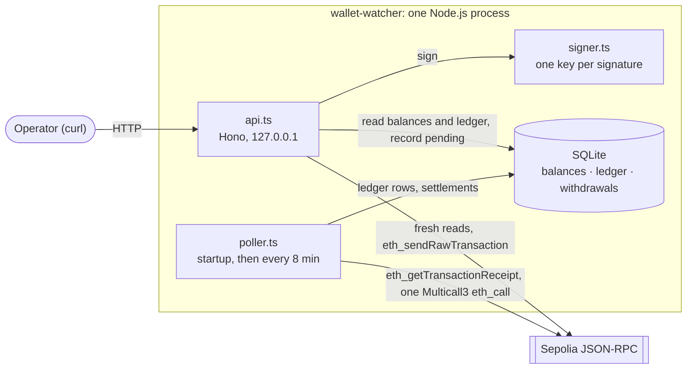
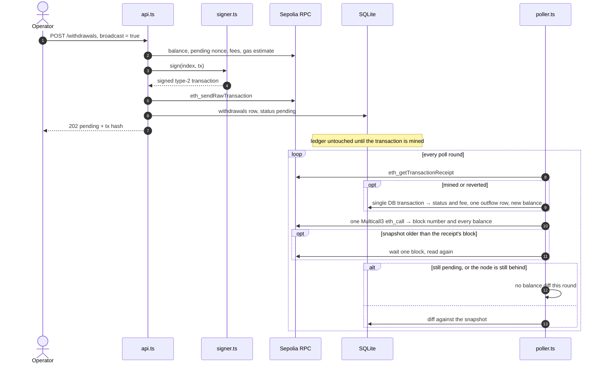

# Wallet Watcher

[](https://github.com/SiegfriedBz/wallet-watcher/actions/workflows/ci.yml)

A self-contained slice of a custody backend, on **Ethereum Sepolia**, in Node.js and TypeScript. It:

- derives **N HD wallets** (1 to 20) from one BIP-39 mnemonic,
- tracks their **ETH balances** and records every change in an append-only ledger,
- builds and signs **EIP-1559 withdrawals**, and optionally broadcasts them,
- exposes all of it through a small **localhost HTTP API**.

**Stack:** Node.js 24 · TypeScript (strict) · [viem](https://viem.sh) · [Hono](https://hono.dev) · [Zod](https://zod.dev) · SQLite (`node:sqlite`) · Vitest · Biome

> [!WARNING]
> Testnet only. The service refuses to start on any chain other than Sepolia. Never use a mnemonic that holds real funds.

## Highlights

- **Exactly-once outflows.** A broadcast is recorded as `pending`. The poller then writes **one** `outflow` from the transaction receipt (amount + real fee), never from a balance diff. → [Broadcast and settlement](#broadcast-and-settlement)
- **Exact amounts.** `bigint` wei in code, decimal strings in JSON and SQLite, no floating point anywhere money is handled. → [Amounts and precision](#amounts-and-precision)
- **Block-consistent reads.** Each round reads every balance in one Multicall3 `eth_call`, together with the block it came from, and never compares against a block older than one it already relied on. → [Balance tracking](#balance-tracking)
- **Worst-case fee check.** A withdrawal is signed only if `balance ≥ value + gasLimit × maxFeePerGas`, on the balance read just before signing, so the network cannot reject it for lack of funds unless that balance drops before it is mined. → [Withdrawals](#withdrawals)
- **Key isolation.** Only `signer.ts` signs, with one wallet's key derived for one signature. No private key is ever stored or returned, and the HTTP layer never sees the mnemonic or the RPC client. → [Key material and secrets](#key-material-and-secrets)
- **Testnet enforced, not just documented.** `eth_chainId` is checked at startup, and chain id `11155111` is signed into every transaction, so none can be replayed on another chain.

**Contents:** [Requirements coverage](#requirements-coverage) · [Quick start](#quick-start) · [Walkthrough on Sepolia](#walkthrough-on-sepolia) · [Configuration](#configuration) · [API](#api) · [How it works](#how-it-works) · [Amounts and precision](#amounts-and-precision) · [Key material and secrets](#key-material-and-secrets) · [Deposit handling](#deposit-handling) · [Design choices and trade-offs](#design-choices-and-trade-offs) · [Known limitations](#known-limitations) · [Path to production](#path-to-production) · [Development](#development)

## Requirements coverage

| # | Requirement | Implementation | Verified by |
|---|---|---|---|
| 1 | **Wallet generation**: N from 1 to 20, deterministic and index-ordered | BIP-44 path `m/44'/60'/0'/0/i` from one mnemonic ([`generate-wallets.ts`](src/generate-wallets.ts)) | Hardhat test vector; N + m keeps the first N; N − m is a prefix; 0 and 21 rejected ([tests](test/generate-wallets.test.ts)) |
| 2 | **Balance tracking**: a change reflected within 10 minutes, persisted | Poller at startup, then every 8 minutes, all balances in one Multicall3 snapshot; SQLite ([`poller.ts`](src/poller.ts), [`chain.ts`](src/chain.ts), [`db.ts`](src/db.ts)) | [Poller](test/poller.test.ts), [chain](test/chain.test.ts) and [DB](test/db.test.ts) tests; live inflows on Sepolia |
| 3 | **Balance-change log**: inflows by tracking, outflows only when broadcast | Append-only `ledger` table, served at `GET /wallets/:index/ledger`; an `outflow` is written only for a transaction this service broadcast, once mined | Build-and-sign writes nothing; a broadcast gives exactly one `outflow` ([API](test/api.test.ts) and [poller](test/poller.test.ts) tests, [real run](#walkthrough-on-sepolia)) |
| 4 | **Withdrawal**: build from a selected wallet; JSON with payload and signature; broadcast optional | EIP-1559 transaction, worst-case fee check, key derived at signing ([`withdrawal.ts`](src/withdrawal.ts), [`signer.ts`](src/signer.ts)) | Max sendable amount exact to the wei; signer recovered from the signature ([withdrawal](test/withdrawal.test.ts) and [signer](test/signer.test.ts) tests) |
| 5 | **API**: (a) addresses and balances, (b) create and optionally broadcast | `GET /wallets`, `POST /withdrawals`, plus `GET /wallets/:index/ledger` ([`api.ts`](src/api.ts)) | [API tests](test/api.test.ts) |
| 6 | **Unit tests** on wallet generation and transaction building | 156 tests in 12 files, with no network and no secrets | `pnpm test`, and CI on every pull request and every push to `main` |
| — | **Deposit handling** described | [Deposit handling](#deposit-handling) | — |
| — | **Testnet only** | Startup check of `eth_chainId` ([`chain.ts`](src/chain.ts)) | [Chain tests](test/chain.test.ts) |
| — | **No secrets committed** | `.env` is git-ignored and has never been committed; `.env.example` holds no secret (empty values, and the default `PORT`) | [Config](test/config.test.ts) and [error](test/errors.test.ts) tests: secrets never appear in messages |

## Quick start

**Prerequisites:** Node.js ≥ 22.13 (for the built-in `node:sqlite`; tested on 24.21; Node 22, and Node 24 before 24.15, print a harmless `ExperimentalWarning` for it at startup), pnpm 10, and a Sepolia RPC URL (Alchemy, Infura, or a public endpoint).

```bash
pnpm install
cp .env.example .env
pnpm generate:mnemonic   # prints a fresh testnet mnemonic: paste it into .env
openssl rand -hex 32     # prints a random admin key: paste it into .env
```

Fill in `.env`:

```bash
MNEMONIC="word1 word2 ... word12"
WALLET_COUNT=5
RPC_URL=https://eth-sepolia.g.alchemy.com/v2/<your-key>
PORT=3000                # optional, defaults to 3000
ADMIN_API_KEY=<64 hex characters from openssl>
```

Start the service from the repository root (`.env` and `data/` are resolved from the working directory):

```bash
pnpm start
```

```
✅ Watching 5 wallets on Sepolia
  #0  0x59638CB7b5DDe8F0635AF53cFAAA0748a6374Ed5
  #1  0x8c10Cce599693f9D0c9c3C14B130f3137379E873
  ...
✅ API on http://127.0.0.1:3000
[poller] wallet #0: initial 0 wei
...
```

In another terminal:

```bash
curl -s http://127.0.0.1:3000/wallets
```

## Walkthrough on Sepolia

The full flow takes up to about 15 minutes, mostly waiting for the poller. Restarting the service (`Ctrl+C`, then `pnpm start`) polls at once. Since the Glamsterdam upgrade (on Sepolia since 6 October 2026), a first transfer to a never-used address uses 204,600 gas instead of 21,000 (its estimate, about 207,000, sets the worst case: about 0.0002 ETH at a `maxFeePerGas` of 1 gwei, on top of the amount).

1. **Deposit.** Send some Sepolia ETH (from a faucet or another wallet) to wallet #0. At the next poll, the log shows `[poller] wallet #0: inflow <delta> wei`, and `GET /wallets` shows the new balance.

2. **Build and sign, without broadcasting.** Nothing is sent and nothing is recorded:

   ```bash
   KEY=$(grep '^ADMIN_API_KEY=' .env | cut -d= -f2)
   TO=0x...   # wallet #1's address from the startup log, to see both sides in the ledger

   curl -s -X POST http://127.0.0.1:3000/withdrawals \
     -H "Authorization: Bearer $KEY" \
     -H "Content-Type: application/json" \
     -d "{\"fromIndex\":0,\"to\":\"$TO\",\"amountEth\":\"0.0005\"}"
   ```

   The response is the signed transaction: its payload (`transaction`), the `signature` (`r`, `s`, `yParity`), and `serializedTransaction` (`0x02…`), which is ready to broadcast as-is.

3. **Broadcast.** Send the same request with `"broadcast":true`. The service replies `202` with `"status":"pending"` and the transaction hash, to look up on `https://sepolia.etherscan.io/tx/<hash>`. At the first poll after it is mined, for example:

   ```
   [poller] wallet #0: outflow -523183071527000 wei (mined, tx 0x6e8ec949adf6c92f17fe2bb109bf8c79441788312e67a60f1fbe560c5ad1e4a0)
   [poller] wallet #1: inflow 500000000000000 wei
   ```

4. **Read the ledger.** Every balance change of a wallet, oldest first:

   ```bash
   curl -s http://127.0.0.1:3000/wallets/0/ledger
   ```

**A real run.** Wallet #0 received 0.001 ETH, then sent 0.0005 ETH to wallet #1 with `"broadcast":true`. These are the ledger rows the service wrote ([wallet #0's full response](#get-walletsindexledger)):

| Row | Wallet | Type | Delta (ETH) | Balance after (ETH) | Tx |
|---|---|---|---|---|---|
| 13 | #0 | `inflow` | +0.001 | 0.001 | — |
| 14 | #0 | `outflow` | −0.000523183071527 | 0.000476816928473 | [`0x6e8e…e4a0`](https://sepolia.etherscan.io/tx/0x6e8ec949adf6c92f17fe2bb109bf8c79441788312e67a60f1fbe560c5ad1e4a0) |
| 15 | #1 | `inflow` | +0.0005 | 0.0005 | — |

- Row 14 is **one** row for the whole spend: 0.0005 ETH plus the real fee of 0.000023183071527 ETH (21,000 gas × 1.103955787 gwei), under the 0.000024728757984 ETH worst case checked before signing.
- Inflows carry no transaction hash: a balance diff does not know which transaction caused it (see [Deposit handling](#deposit-handling)).
- Rows 1 to 12 are the `initial` readings of the 12 wallets watched at the time.
- The run dates from 1 October 2026, before two later changes: balances read in one Multicall3 call (which changes how balances are read, not which rows are written), and the Glamsterdam upgrade (the first transfer to wallet #1 cost 21,000 gas). On 17 October, the current poller, run against a copy of this database, read all 12 balances in one call and wrote no row: the ledger still matches the chain.

## Configuration

Settings are read from `.env`; a variable already set in the environment takes precedence. They are validated once at startup (Zod), and the service exits before touching the chain or the database if anything is invalid. Error messages name the variable, never its value.

| Variable | Rule |
|---|---|
| `MNEMONIC` | A valid BIP-39 phrase, 12 to 24 words, checksum verified, so a typo is caught at startup instead of silently deriving other wallets (a misspelled word always; a swap for another valid word 15 times out of 16 with 12 words). Surrounding spaces are ignored. |
| `WALLET_COUNT` | Digits only, an integer from 1 to 20 (`"3.5"`, `"0x10"`, `"1e1"`, `" 7 "` are rejected). |
| `RPC_URL` | A URL to a **Sepolia** node, checked at startup with `eth_chainId`. Never logged: providers put the API key in the URL. |
| `PORT` | Optional. Digits only, 1 to 65535. Default `3000`. |
| `ADMIN_API_KEY` | Required, at least 32 characters. Bearer token for `POST /withdrawals`. Generate it with `openssl rand -hex 32`: only the length is checked at startup, and a key with characters outside the token alphabet (letters, digits, `-._~+/`, and `=` at the end) would get every request refused with `400`. |

## API

The API listens on `127.0.0.1` only: it is an admin tool, not reachable from other machines.

| Method | Path | Auth | Returns |
|---|---|---|---|
| `GET` | `/health` | — | `{ "status": "ok" }` |
| `GET` | `/wallets` | — | Every watched wallet with its stored balance |
| `GET` | `/wallets/:index/ledger` | — | One wallet's balance-change log, oldest first |
| `POST` | `/withdrawals` | `Bearer ADMIN_API_KEY` | A signed withdrawal transaction, optionally broadcast |

Reads need no key: addresses, balances and their movements are public on-chain anyway. Anything that signs needs the admin key. Every amount, in requests and responses, is a **string**: `JSON.parse` reads numbers as doubles, which lose precision. Unknown routes return `404` with `{ "error": "Not found" }`.

### `GET /wallets`

```json
{
  "chainId": 11155111,
  "lastPolledAt": "2026-10-01T17:10:02.114Z",
  "wallets": [
    {
      "index": 0,
      "address": "0x5963…4Ed5",
      "balanceWei": "1000000000000000",
      "balanceEth": "0.001",
      "balanceChangedAt": "2026-10-01T12:38:09.393Z"
    }
  ]
}
```

| Field | Meaning |
|---|---|
| `lastPolledAt` | Start of the last poll round whose balance snapshot was used: every balance was read on-chain after this time. `null` until then. A round whose balance read failed, or whose node was still behind, does not count, and a wallet with a pending withdrawal is only refreshed once it settles. |
| `balanceWei` / `balanceEth` | The stored balance, exact. `balanceEth` is for display. `null` if the wallet has not been polled yet. |
| `balanceChangedAt` | When this wallet's balance last changed (not when it was last checked). |

Only wallets `0` to `WALLET_COUNT − 1` are listed. A broadcast withdrawal shows in the balance only once it is mined and settled by the poller.

### `GET /wallets/:index/ledger`

The ledger rows of one watched wallet, oldest first. For wallet #0 of the [real run](#walkthrough-on-sepolia):

```json
{
  "index": 0,
  "address": "0x59638CB7b5DDe8F0635AF53cFAAA0748a6374Ed5",
  "entries": [
    {
      "type": "initial",
      "deltaWei": "0",
      "deltaEth": "0",
      "balanceAfterWei": "0",
      "balanceAfterEth": "0",
      "txHash": null,
      "createdAt": "2026-10-01T12:30:07.837Z"
    },
    {
      "type": "inflow",
      "deltaWei": "1000000000000000",
      "deltaEth": "0.001",
      "balanceAfterWei": "1000000000000000",
      "balanceAfterEth": "0.001",
      "txHash": null,
      "createdAt": "2026-10-01T12:38:09.393Z"
    },
    {
      "type": "outflow",
      "deltaWei": "-523183071527000",
      "deltaEth": "-0.000523183071527",
      "balanceAfterWei": "476816928473000",
      "balanceAfterEth": "0.000476816928473",
      "txHash": "0x6e8ec949adf6c92f17fe2bb109bf8c79441788312e67a60f1fbe560c5ad1e4a0",
      "createdAt": "2026-10-01T19:10:00.948Z"
    }
  ]
}
```

| Field | Meaning |
|---|---|
| `type` | `initial`, `inflow`, `outflow` or `external_outflow` (see [Storage](#storage)). |
| `deltaWei` / `deltaEth` | The signed change: negative for outflows. |
| `balanceAfterWei` / `balanceAfterEth` | The balance right after this change. |
| `txHash` | The withdrawal's hash for an `outflow`; `null` otherwise, since a balance diff does not know the transaction. |
| `createdAt` | When the service recorded the change, not the block time. |

`404` if the index is not a watched wallet, or not a number.

### `POST /withdrawals`

Builds and signs a transaction that sends ETH from one watched wallet to any address. By default it is **not broadcast**: nothing moves on-chain and nothing is recorded. With `"broadcast": true`, the service also sends it and records it (see [Broadcast and settlement](#broadcast-and-settlement)).

**Request**

| Field | Rule |
|---|---|
| `fromIndex` | Integer from `0` to `WALLET_COUNT − 1`. Only watched wallets can send. |
| `to` | An Ethereum address, lowercase or with a correct EIP-55 checksum (a mixed-case typo is rejected). Not the zero address, and not the sending wallet itself. |
| `amountEth` | A **string** in ETH, e.g. `"0.0005"`: digits, at most 18 decimals, greater than 0. No sign, no exponent, no JSON number. |
| `broadcast` | Optional boolean, default `false`. |

Unknown fields are rejected.

**Response `200`** (not broadcast)

```json
{
  "broadcast": false,
  "from": "0x5963…4Ed5",
  "hash": "0x…",
  "transaction": {
    "type": "eip1559",
    "chainId": 11155111,
    "to": "0x8c10…E873",
    "valueWei": "500000000000000",
    "valueEth": "0.0005",
    "nonce": 0,
    "gas": "21000",
    "maxFeePerGas": "…",
    "maxPriorityFeePerGas": "…",
    "maxFeeWei": "…"
  },
  "signature": { "r": "0x…", "s": "0x…", "yParity": 0 },
  "serializedTransaction": "0x02…"
}
```

| Field | Meaning |
|---|---|
| `transaction` | The payload that was signed. `maxFeeWei` = `gas × maxFeePerGas`, the most the fee can be. |
| `signature` | The ECDSA signature by the `from` wallet. Anyone can recover the signer's address from it and the payload. |
| `serializedTransaction` | Payload + signature, encoded as an EIP-2718 type-2 transaction (`0x02…`). Ready to broadcast as-is. |
| `hash` | `keccak256(serializedTransaction)`: the transaction id Etherscan shows once it is broadcast. |

**Response `202`** (`"broadcast": true`): the same body, with `"broadcast": true` and `"status": "pending"`. The transaction was sent; the ledger records the outflow at the first poll after it is mined.

**Errors**, in the order they are checked:

| Status | When | Body |
|---|---|---|
| `401` / `400` | No key or a wrong key (`401`), or a malformed `Authorization` header (`400`). Rejected by the auth middleware: nothing else runs. | Plain text, with a `WWW-Authenticate` header |
| `400` | The body is not JSON, or a field is invalid. No chain call. | `{ "error": "Invalid request", "issues": [{ "field", "message" }] }` |
| `409` | `broadcast: true`, but the wallet has a broadcast withdrawal that the poller has not settled yet (until the first poll after it is mined), or has not been polled yet. | `{ "error" }` |
| `422` | Valid request, but the balance cannot cover amount + worst-case fee. | `{ "error", "balanceWei", "maxFeeWei", "maxSendableWei", "maxSendableEth" }` |
| `502` | `broadcast: true`, but sending failed. Nothing is recorded; read [Broadcast and settlement](#broadcast-and-settlement) before retrying. | `{ "error" }` |
| `500` | Unexpected error (e.g. the RPC is down during the fresh reads). Details are logged, never returned. | `{ "error": "Internal server error" }` |

## How it works

### Architecture



`index.ts` is the composition root: it validates the config, derives the addresses, checks the chain, opens the database, starts the poller, then the API. The money logic lives in pure modules with no I/O (`withdrawal.ts`, `settlement.ts`, `balance-change.ts`), unit-tested directly. I/O stays at the edges (`chain.ts`, `db.ts`, `api.ts`, `poller.ts`).

### Wallet derivation

- BIP-39 mnemonic → seed → BIP-32 tree, at the BIP-44 path `m/44'/60'/0'/0/i` (coin type 60 = Ether, account 0, external chain, address index `i`). This is MetaMask's path: importing the mnemonic shows wallet #0 as Account 1, #1 as Account 2, and so on.
- Deterministic: the same mnemonic and index always give the same address. Raising `WALLET_COUNT` appends wallets; lowering it keeps the first ones.
- Derivation returns `{ index, address }` only. Database rows are keyed by address, not index, so a different mnemonic can never inherit another wallet's history.

### Balance tracking

The service **polls** balances instead of following transfers: a balance diff catches every change, whether or not a log announces it. Plain ETH transfers emitted no logs at all until the Glamsterdam upgrade added them (EIP-7708, on Sepolia since 6 October 2026, not yet on mainnet; see [Deposit handling](#deposit-handling)). At startup, then 8 minutes after each round finishes (rounds never overlap), a round:

1. **Settles** each pending withdrawal whose receipt is available (one `eth_getTransactionReceipt` per pending withdrawal).
2. **Reads every balance in one call**: a single `eth_call` to the [Multicall3](https://github.com/mds1/multicall3) contract returns `getBlockNumber()`, then `getEthBalance(address)` for each wallet.
3. **Compares** each wallet with its stored balance, and writes a row only when something changed.

**Why one call.** An `eth_call` runs on one node, against one block, so the balances and the block number it returns always describe the same state. Behind a load-balanced RPC, separate calls can reach nodes a block apart: a receipt from a node that has the withdrawal's block, then a balance from one that does not, would record a false `inflow`. With the block number in hand, the poller never compares against a block older than a receipt it just applied, or than the previous round's snapshot. It waits one block (12 s) and reads again; if the node is still behind, nothing is compared until the next round.

- A change is reflected within 8 minutes plus one round. A round is one RPC call per pending withdrawal plus one for all balances (about 0.1 s for 12 wallets on a public Sepolia node), well inside the 10-minute requirement.
- A failed receipt read is logged, and the other wallets go on. If the balance read fails, nothing is compared, `lastPolledAt` does not advance, and the next round tries again.
- Balances are read at the `latest` block, with no confirmation depth (see [Known limitations](#known-limitations)).

The API serves balances from the database, never from the chain: responses are fast, consistent with the ledger, and still available when the RPC is down. `lastPolledAt` shows how fresh they are (a wallet with a pending withdrawal is refreshed once it settles). Withdrawals do the opposite.

### Withdrawals

| Step | Check or action | On failure |
|---|---|---|
| 1 | Admin key, compared in constant time | `401` / `400`, nothing else runs |
| 2 | Strict validation: wallet index, address checksum, destination neither the zero address nor the sender, amount string → wei with `parseEther` | `400`, no chain call |
| 3 | Broadcast only: no withdrawal pending for this wallet, and the wallet already polled | `409` |
| 4 | Fresh chain reads: balance, nonce (`pending` tag), EIP-1559 fees, then a gas estimate | `500` |
| 5 | Funds check: `balance ≥ value + gas × maxFeePerGas` | `422`, with the max sendable amount |
| 6 | Build the type-2 transaction (chain id `11155111`), derive the wallet's key, sign | — |
| 7 | Not broadcast: return it (`200`), record nothing. Broadcast: `eth_sendRawTransaction`, record it as `pending` (`202`) | `502`, nothing recorded |

- **Fresh chain state, never the database.** The stored balance can be minutes old; a spend is always decided on the current on-chain balance.
- **Worst-case fee.** Under EIP-1559, a transaction pays `gasUsed × min(maxFeePerGas, baseFee + maxPriorityFeePerGas)`, and nodes refuse it unless the balance covers `value + gasLimit × maxFeePerGas`. The service checks exactly that bound, on the balance read just before signing, so a signed withdrawal cannot be rejected for lack of funds unless that balance drops before it is mined (for example, another spend from the same wallet). Fees come from viem's `estimateFeesPerGas` (`maxFeePerGas = 1.2 × baseFee + maxPriorityFeePerGas`). As a result, sending a wallet's entire balance always fails, and the `422` says how much can be sent instead.
- **Gas** comes from `eth_estimateGas`, so recipients that cost more than a plain 21,000-gas transfer are handled: contracts and, on Sepolia since Glamsterdam, never-used addresses (204,600 gas used, of which 183,600 pay for the new account's state; `eth_estimateGas` returns 207,391; measured on 17 October 2026). When the amount alone is at least the balance, the funds check must fail and the node may refuse to estimate, so 21,000 is used instead: the max sendable amount in the `422` is then an upper bound.
- **Nonce** is read with the `pending` block tag, so a transaction still waiting in the mempool is not reused.
- **Signing** derives the private key of that one wallet, signs, and returns only the signed transaction and its signature. The key is never stored.

### Broadcast and settlement

The real fee is known only once the transaction is mined, so a broadcast is recorded in two steps, linked by the transaction hash:



| When | What is written |
|---|---|
| At broadcast | A `withdrawals` row: `pending`, amount, tx hash. The ledger is not touched: the balance has not changed yet. |
| At the first poll after mining | In one database transaction: status `mined` (or `reverted`) and the real fee (`gasUsed × effectiveGasPrice`), **one** `outflow` ledger row of −(amount + fee), or −fee if reverted, and the new balance. |

**Why the outflow is counted exactly once.** While a withdrawal is pending, the poller skips that wallet's balance diff. The transaction can be mined at any moment, including between the receipt check and the balance read; a diff would then record the drop as an `external_outflow`, and the settlement would record it a second time. Skipping the diff makes the receipt the only source of an outflow. And once settled, the wallet is only compared against a snapshot at or after the receipt's block, so a node that is behind cannot book the drop back as an inflow. After settlement, the stored balance matches the chain again, and any deposit received in the meantime is recorded as an `inflow` in the same round.

| Case | Behaviour |
|---|---|
| Sending fails | `502`, nothing recorded. If the node accepted the transaction anyway (e.g. the response timed out), it can still be mined; the poller then records it as `external_outflow`. So check the address on a block explorer before retrying: if the first transaction did reach the node, a retry gets the next nonce, and both are sent. |
| Crash between sending and recording (milliseconds) | The poller sees the drop and records `external_outflow`: the balance stays correct, and the event is flagged. |
| Transaction reverted | `outflow` = −fee only (the gas is paid, the amount stays), status `reverted`. |
| Deposit while a withdrawal is pending | Recorded as `inflow` right after the settlement. |
| Balance read reaches a node behind the receipt's block | The poller waits one block and reads again. If the node is still behind, nothing is compared until the next round: no false row. |
| Never mined | The wallet stays pending (see [Known limitations](#known-limitations)). |

### Storage

A local SQLite file, `data/wallet-watcher-<chainId>.db`, created at first start. There is no database server to install, and there is one file per chain, so balances from different networks never mix.

| Table | Content |
|---|---|
| `balances` | One row per wallet: the current balance and when it last changed. |
| `ledger` | One row per balance change, never edited or deleted: type, signed delta, balance after, tx hash (outflows only), timestamp. |
| `withdrawals` | One row per broadcast: tx hash, wallet, destination, amount, status (`pending` → `mined` / `reverted`), real fee. |

Writes that belong together (a balance and its ledger row; a settlement, its ledger row and the new balance) happen in a **single transaction**, so the tables agree even after a crash.

The `withdrawals` table is not served over HTTP. To see a broadcast's status and real fee, read the file directly (read-only):

```bash
node -e 'const { DatabaseSync } = require("node:sqlite"); console.table(new DatabaseSync("data/wallet-watcher-11155111.db", { readOnly: true }).prepare("SELECT tx_hash, wallet_index, value_wei, status, fee_wei FROM withdrawals").all())'
```

| Ledger type | Meaning |
|---|---|
| `initial` | First reading of a wallet, even at 0. |
| `inflow` | The balance went up, whatever the source. |
| `outflow` | A withdrawal this service broadcast, once mined: −(amount + real fee), with its tx hash. |
| `external_outflow` | The balance went down with no recorded withdrawal behind it: the same mnemonic used in another wallet, or a transaction the service signed but did not record (a sign-only one broadcast by hand, a `502` that went through, a crash between sending and recording). In a real custody system this is an alert. |

## Amounts and precision

Ether has 18 decimals, so amounts in wei quickly outgrow fixed-size number types:

| Type | Every integer exact up to | As wei, in ETH |
|---|---|---|
| JavaScript `number` | 2⁵³ − 1 | ≈ 0.009 ETH |
| SQLite `INTEGER` | 2⁶³ − 1 | ≈ 9.22 ETH |
| `bigint` | No limit | — |

So:

- **In code**, every amount is a `bigint` in wei: balances, deltas, values, gas, fees. There is no floating point anywhere money is handled.
- **In SQLite**, amounts are `TEXT` (decimal wei), turned back into `bigint` on read.
- **In JSON**, every amount is a string. Responses give `…Wei` (exact) and `…Eth` (`formatEther`, also exact, for display).
- **In requests**, `amountEth` must be a string matching `^\d+(\.\d{1,18})?$`, converted once with `parseEther`. JSON numbers are rejected: `JSON.parse` turns them into doubles before any validation runs, so `1.000000000000000001` would already have become `1`.
- **Fees** are computed in `bigint` too: `gas × maxFeePerGas` before signing, `gasUsed × effectiveGasPrice` at settlement.

The tests check exact conversions up to 27 significant digits, values above 2⁶³ stored and read back through SQLite, and the max sendable amount to the wei (one wei more fails).

## Key material and secrets

**Trust boundary: the process, and the `.env` file it loads.** The mnemonic is the most sensitive secret, the root of every wallet (the admin key and the RPC URL are the other two). It sits in plain text in `.env`, and from startup until exit in the process memory and environment: anything that can read one of them controls all the wallets. That is acceptable on a testnet, and it is the first thing a [production version](#path-to-production) changes.

Within that boundary:

| Concern | Measure |
|---|---|
| Secrets in git | `.env` is git-ignored and has never been committed. `.env.example` holds no secret (empty values, and the default `PORT`). |
| Secrets in logs and errors | The mnemonic and the admin key are never logged or returned. Config errors name the variable, never its value (tested). |
| RPC API key | Providers put it in the URL, and viem's full error messages include the URL. Only viem's `shortMessage` is ever logged (tested). |
| Private keys | Never stored, cached, logged or returned. `signer.ts`, the only place that signs, derives one wallet's key per signature. Address derivation also derives each key once at startup, only to compute its address, and returns `{ index, address }` only. |
| Least privilege | `api.ts` receives functions (read withdrawal inputs, sign, broadcast, and the poller's `lastPolledAt`), never the mnemonic or the RPC client. The RPC client is a viem public client with no account: it relays signed transactions, but cannot sign one. |
| A signed transaction is a bearer instrument | Anyone holding a `serializedTransaction` can broadcast it. So `POST /withdrawals` requires the admin key even without `broadcast`, compared in constant time (Hono `bearerAuth`). |
| Replay | The chain id (`11155111`) is part of the signed EIP-1559 payload: a signed withdrawal is invalid on mainnet or any other chain. |
| Wrong network | `eth_chainId` is checked at startup. On any chain other than Sepolia, the service refuses to start, before the database or the poller. |
| Destinations | Mixed-case addresses must pass the EIP-55 checksum, which catches typos (an all-lowercase address has no checksum to check). The zero address and the sending wallet itself are refused. Only watched wallets can send. |
| Exposure | The API binds to `127.0.0.1`. The request log contains method, path, status and duration, never bodies or headers. A `500` returns a generic message. |

## Deposit handling

The service compares balances between two polls; it does not read individual transactions. Deposits are deliberately not itemized per transaction. This is what gets recorded:

| Situation | What is recorded |
|---|---|
| Several deposits within one polling interval (+0.1, then +0.2 ETH) | **One** `inflow` row of +0.3 ETH, without a tx hash. Individual deposits are not distinguished. |
| A deposit and an external spend within one interval (+0.1, then −0.05 ETH) | **One** row for the net change: an `inflow` of +0.05 ETH. |
| Service offline for a while | Nothing while offline. On restart, the first round settles any withdrawal mined in the meantime, then records **one** row for the remaining change. No funds are missed in the balance; only the per-deposit detail is lost. |
| A wallet not watched for a while (`WALLET_COUNT` lowered, then raised) | Same as offline: one row covering the whole gap. |

A balance diff also catches inflows that a scan of transactions sent to the wallet would miss: ETH sent by contracts (internal transfers from multisigs, batch payouts or bridges), and validator withdrawals, which credit a balance with no transaction at all. What it cannot do is attribute: it sees net changes, not the transactions behind them.

Per-deposit detail would need transaction-level data: an indexer, trace APIs (`trace_filter`, `debug_traceBlockByNumber`) for internal transfers, or a provider webhook such as Alchemy Address Activity. That is out of scope here.

**ETH transfer logs (EIP-7708).** The Glamsterdam upgrade, live on Sepolia since 6 October 2026 (block 11,856,337) and not yet on mainnet, makes every successful ETH transfer with a nonzero value emit an ERC-20-style `Transfer(from, to, amount)` log from the system address `0xff…fe`, including transfers made by contracts. On Sepolia, attributing deposits is now one `eth_getLogs` away (that address, the `Transfer` topic, the wallet as `to`), with the transaction hash. The balance diff would stay the source of truth: validator withdrawals are not logged, and logs must be read again after a reorg.

## Design choices and trade-offs

| Choice | Why | Trade-off |
|---|---|---|
| Ethereum Sepolia, native ETH | The worst-case fee is exactly `gasLimit × maxFeePerGas` | On an L2 (e.g. Base), an L1 data fee would need estimating on top |
| Polling every 8 minutes | Simple, no third-party dependency, catches every kind of inflow, catches up after downtime | Deposits within one interval are merged; up to 8 minutes of delay |
| All balances in one Multicall3 `eth_call` | One node, one block, with its number: a node that is behind is detected, and a round costs one balance call instead of one per wallet | Relies on the Multicall3 contract (on Sepolia and most EVM chains); if that one call fails, the round compares nothing |
| Balances read at `latest` | Meets the 10-minute requirement (`finalized` trails the head by about 13 minutes) | No confirmation depth: a reorg could undo a recorded change |
| SQLite via `node:sqlite` | Real transactions, a single local file, nothing to install | A single instance; a younger API than established drivers |
| API serves balances from the DB | Fast, consistent with the ledger, works when the RPC is down | Up to one interval old (`lastPolledAt` shows how old), longer for a wallet with a pending withdrawal |
| Withdrawals read the chain fresh | A stale balance must never decide a spend | RPC round-trips on every withdrawal |
| Funds check on the worst-case fee | The network cannot reject the transaction for lack of funds while the balance holds | The last fraction of a balance cannot be sent while fees are high |
| Amounts in ETH, as strings | Readable, and exact (`parseEther`, at most 18 decimals) | Callers must send a string, not a number |
| Pending at broadcast, outflow at mining | One exact ledger row with the real fee; a sent transaction can still revert | The outflow appears up to one interval after mining |
| One pending withdrawal per wallet | Simple settlement, no nonce juggling | A second broadcast from the same wallet is refused (`409`) until the poller settles the first |
| Settlement in the poller, not in the request | The request returns at once; pending state survives a restart (it is in the DB) | No "mined" notification: the `outflow` appears in the ledger after the next poll |
| Admin key + localhost | Simple, no external service | One shared secret: no per-user identity or audit trail |
| Withdrawals from each wallet directly | Keeps the scope small | Production would sweep deposit wallets into a hot/cold structure |

## Known limitations

- **No confirmation depth.** Balances are read at the `latest` block, and a withdrawal is settled on its first receipt, so a reorg could undo a recorded change. Waiting for finality would break the 10-minute requirement: on Ethereum, the `finalized` block trails the head by at least ~13 minutes (two epochs). Production would credit deposits after N confirmations and re-check settled receipts.
- **A transaction that is never mined** (dropped, or priced out by a base-fee spike) keeps its wallet pending: no new broadcast, and no balance diff for that wallet, so a deposit to it is not recorded either. Production would monitor it and replace it (same nonce, higher fees).
- **Two broadcasts for the same wallet at the same instant** can both pass the one-pending check (check, then insert after the send: not atomic). Usually both read the same nonce and the node rejects the second (`502`). But a second one paying at least 10% more would replace the first, which would then stay pending forever, and one that reads the nonce after the first reached the node gets the next nonce, so both are sent. A per-wallet lock around check → sign → send would close the gap.
- **The block floor lives in memory.** Within a run, no snapshot older than the previous one is ever compared. After a restart, the first round only checks it against the receipts it applies, so a node behind the previous run's last read would go unnoticed. Storing the block number with each ledger row would close that (see [Path to production](#path-to-production)).
- **The 10-minute bound assumes a responsive RPC.** viem gives up on an attempt after 10 s and retries timeouts and server errors up to 3 times (about 41 s at worst for one request), and a node behind the receipt's block costs a 12-second wait, so a degraded RPC can stretch a round past the 2-minute margin, or push a comparison to the next round.
- **The `422`'s max sendable amount can be too high** when the amount is at least the balance: the gas then assumed is 21,000, while on Sepolia since Glamsterdam a first transfer to a never-used address costs 204,600. No transaction is affected: the next request estimates the real gas and checks the funds again.
- **Deposits are not itemized** (see [Deposit handling](#deposit-handling)), and the ledger endpoint returns every row, without pagination (fine at this scale).

## Path to production

What this slice leaves out on purpose, roughly in the order a real custody system would need it:

1. **Key management.** No mnemonic in the environment or in process memory: sign in a KMS/HSM or with MPC, so keys never enter the service. Watching needs no signing key: addresses at `m/44'/60'/0'/0/i` derive from the account's extended public key (`m/44'/60'/0'`), because the last two levels are not hardened. That xpub is still confidential: it reveals every address, and with any one leaked child key it gives back the account's private key.
2. **Finality.** Credit deposits only after N confirmations (or at the `safe` / `finalized` block), show pending and available balances separately, and re-verify settled receipts against reorgs.
3. **Transaction lifecycle.** A per-wallet nonce manager (several withdrawals in flight), monitoring of stuck transactions with replace-by-fee or cancellation, and a per-wallet lock around check → sign → send.
4. **Withdrawal policy.** Idempotency keys, per-wallet and per-period limits, destination allowlists, approval by a second person above a threshold, and an audit log of who requested what.
5. **Access.** Per-operator identity (an identity provider or mTLS) instead of one shared key.
6. **Deposits.** Per-deposit attribution (EIP-7708 logs where the chain has them, otherwise an indexer, traces or provider webhooks), and sweeping deposit wallets into a hot/cold wallet structure.
7. **Block numbers in the ledger.** Store each snapshot's block number with the rows it produces: it keeps the block floor across restarts, and it is what confirmation counting and reorg checks build on.
8. **Operations.** Postgres with migrations, RPC failover across providers, metrics, an alert on every `external_outflow`, and a `/health` that reports poller freshness.
9. **More assets and chains.** ERC-20 (its `Transfer` logs make itemized deposits easy), and L2s, with an estimated L1 data fee and a margin added to the worst-case cost (that fee has no hard upper bound).

## Development

### Scripts

| Command | What it does |
|---|---|
| `pnpm start` | Start the service (poller + API) |
| `pnpm dev` | Start with auto-restart on file changes |
| `pnpm test` | Run the unit tests (Vitest) |
| `pnpm typecheck` | Type-check with `tsc` |
| `pnpm lint` / `pnpm lint:fix` | Lint and format with Biome |
| `pnpm generate:mnemonic` | Print a fresh testnet mnemonic |

### Tests

```bash
pnpm test
```

156 unit tests in 12 files. No network and no secrets: Hardhat's public test mnemonic (`test test … junk`), an in-memory database, and fake chain clients.

- **Wallet generation**: known test vector, determinism, N + m and N − m, range limits, invalid mnemonics, no key material in the output.
- **Transaction building**: worst-case fee, the exact max sendable amount passes and one wei more fails, sending the whole balance fails.
- **Signing**: the address recovered from the signature is the selected wallet, the signed fields match the request, no key material in the output.
- **Request validation**: exact ETH-to-wei conversion (up to 27 digits), rejected formats (`"1e-3"`, `".5"`, 19 decimals, JSON numbers), address checksums, wallet index range, the sending wallet refused as destination, `broadcast` flag, unknown fields.
- **Balance tracking**: change detection, database writes, precision above 2⁶³, rollback when a write fails.
- **Settlement and poller**: amount + real fee when mined, fee only when reverted; nothing recorded while pending, one outflow once mined, no double count on the next round, a deposit during the pending period recorded afterwards; a node behind the receipt's block read again, with no false inflow; a stale node or a failed read compares nothing.
- **Balance snapshot**: one Multicall3 call, never split and never a silent failure: the block number first, then one balance per wallet; a missing balance fails the read.
- **API**: wallet listing; one wallet's ledger in order with exact signed amounts, and `404` for an index that is not watched; `401` without a key or with a wrong one (and no chain call); `400` before any chain call; `422` with the max sendable amount; a transaction signed by the right wallet, and nothing recorded when not broadcast; with broadcast, `202` and a pending withdrawal but no ledger row yet, `409` when pending or not polled, and `502` records nothing.
- **Config and safety guards**: every accepted and rejected `WALLET_COUNT` and `PORT` format, a required `ADMIN_API_KEY`, secrets never in error messages; an RPC on another network refused; error messages never contain the RPC URL or its key.

### CI

GitHub Actions runs `pnpm typecheck`, `pnpm lint` and `pnpm test` on Node 24, from a frozen lockfile, for every push to `main` and every pull request.

### Project structure

```
src/
  index.ts             composition root: config → wallets → chain check → DB → poller → API
  config.ts            env validation (Zod)
  generate-wallets.ts  HD wallet derivation (addresses only)
  chain.ts             network definition, testnet guard, keyless RPC client, Multicall3 balance snapshot, fresh reads for withdrawals
  poller.ts            per round: settlements, one balance snapshot, diffs
  balance-change.ts    stored vs on-chain balance → ledger type (pure)
  withdrawal.ts        funds check + unsigned EIP-1559 transaction (pure)
  settlement.ts        real cost of a mined withdrawal (pure)
  signer.ts            derives one wallet's key and signs
  db.ts                SQLite schema and queries
  api.ts               HTTP API (Hono)
  shared/              Zod schemas, types, safe error messages
scripts/
  generate-mnemonic.ts
test/                  unit tests (Vitest)
```
